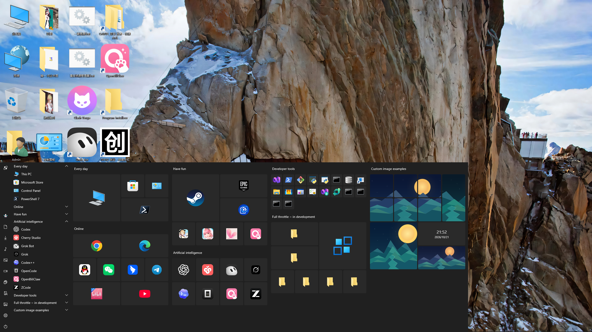
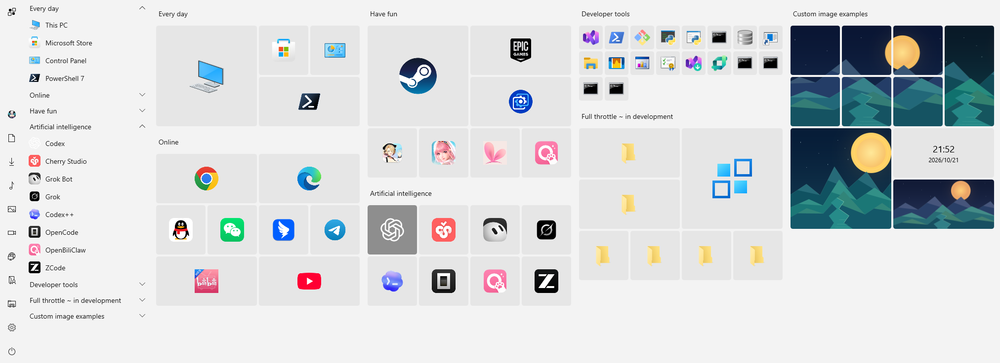
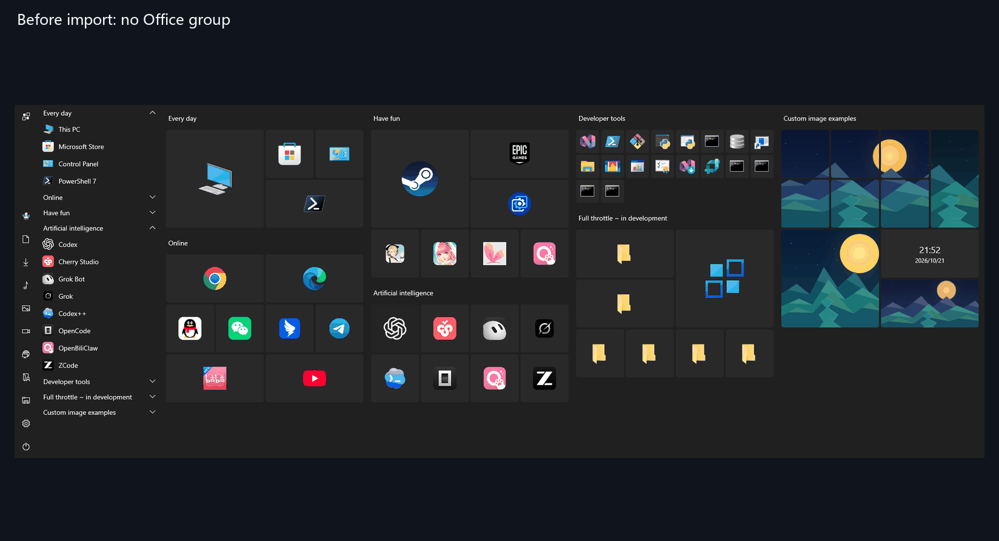

# TileWall

[English → README.md](README.md) · [简体中文 → README.zh-CN.md](README.zh-CN.md)

**A place for the things you open every day.**

Your everyday apps, work folders, and favorite websites are easier to find when they have a place of their own. TileWall is a standalone tile launcher for Windows. Arrange things the way you like, add your own pictures, and bring up the wall with a keyboard shortcut.

If you miss Windows 10 tiles, this should feel familiar. Your usual Start menu and Windows key keep working as they do now.



## What can you put on your wall?

- **The things you use most.** Add apps, files, folders, shortcuts, and websites. Group them by work, games, or whatever makes sense to you, then drag them into place.
- **Pictures you like looking at.** Use a single image or cycle through a folder of pictures. A puzzle lets one image stretch across several tile sections. The whole puzzle shares one launch target.
- **A bit of your own style.** Choose light or dark mode, square or rounded corners, and a background you like. Add a clock and date, or import shortcuts from the Start menu to get going.



## Get TileWall

**TileWall 0.3.1 is available as a portable x64 download. Extract the complete ZIP and run `TileWall.exe`.**

[Check releases](https://github.com/GitRuozhi/TileWall_for_Win11/releases) · [Browse the source](https://github.com/GitRuozhi/TileWall_for_Win11)

TileWall is being developed for Windows 10 22H2 and Windows 11. Windows 11, multiple DPI settings, and a formally signed installation still need full testing. If you would like to build it yourself, the command is at the end of this page.

## Start with a few favorites

Once you have a runnable build:

1. **Open the wall.** Run `TileWall.exe` from the complete publish folder. The default shortcut is <kbd>Win</kbd> + <kbd>~</kbd>, or you can double-click the TileWall icon in the system tray. Use the key that shares the backtick and tilde; no Shift is needed. You can change the shortcut in Settings.
2. **Add the things you reach for most.** Right-click an empty part of the wall and choose **Import**, then **From Start menu**. Nothing is selected at first; select a few entries and choose **Confirm batch import**. Previously cached shortcuts and icons are available while the source list refreshes in the background.
3. **Make yourself at home.** Click a tile to open its target. Drag tiles into place, double-click a group title to rename it, or right-click a tile and choose **Edit** to change its name, picture, and size. Choose **Save** when you are done.



A few useful controls:

| What you want to do | How |
| --- | --- |
| Hide the wall | Press <kbd>Esc</kbd> on the main wall; finish any text editing or dragging first |
| Add something manually | Right-click an empty area to create a tile or puzzle; the clock is under **Add component → Time and date** |
| Move a whole group | Drag its title |
| Keep groups open in the menu | Expand up to five at once; opening a sixth closes the one opened earliest. Expanded groups are remembered by ID across restarts |
| Undo a recent change | Press <kbd>Ctrl</kbd> + <kbd>Z</kbd> on the main wall while an undo point is available |

Settings also includes the theme, background, activation shortcut, and start at login. Get a few useful tiles in place first. The rest can wait until you feel like tinkering.

## A few things to know

- Creating a tile adds it to the wall before opening the editor. Canceling that edit leaves the default tile in place.
- Importing again can rearrange positions. Keeping existing changes preserves things such as pictures, sizes, and titles, rather than the original layout.
- Unpinning leaves the original file alone. Undo it promptly if it was a mistake; there is no list for restoring unpinned items after a restart yet.
- Saved single images and custom wall backgrounds keep their own copy of the original. Picture collections stay linked to the folder you selected.
- Portable builds store data in `%LOCALAPPDATA%\TileWall`. To back up your setup, exit TileWall and copy the whole folder. Packaged builds use a separate data folder; the two do not share data. Automatic migration from older data formats is not available during development.

## Tell me what gets in the way

[Open an issue](https://github.com/GitRuozhi/TileWall_for_Win11/issues) with what you were trying to do, what happened, and your Windows version, display scaling, and TileWall version. A screenshot or short recording helps if you have one.

Ideas are welcome too. What would you like to put on your wall, and which part feels awkward to use?

## License

The plan is to make TileWall free to use, including for internal office use. Formal license terms have not been published; all rights are reserved until then. Public source code does not mean the project has an open-source license, and permission for commercial distribution or derivative products still needs to be clarified. See the [third-party notices](src/TileWall/THIRD-PARTY-NOTICES.txt).

<details>
<summary>Build it yourself</summary>

You need Windows, .NET SDK 10, and the appropriate Windows SDK / Visual Studio C++ build tools. From the repository root:

```powershell
dotnet publish src/TileWall/TileWall.csproj -c Release -r win-x64 --self-contained true -p:Platform=x64 -p:WindowsPackageType=None -o artifacts/Release/TileWall
```

Run `TileWall.exe` from `artifacts/Release/TileWall` and keep the complete folder together. Copying only the EXE, or running from a build folder without the published resources, is not sufficient. This creates a portable build; it is not a claim that the build has passed release testing.

</details>
