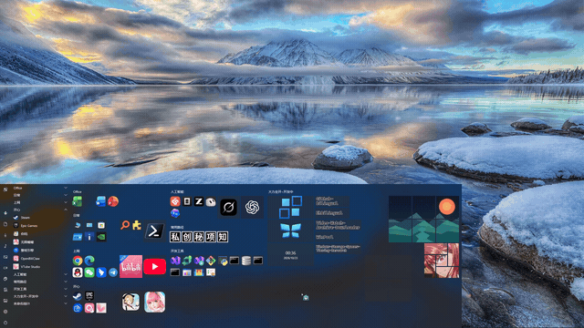
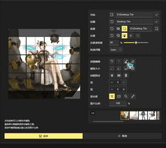
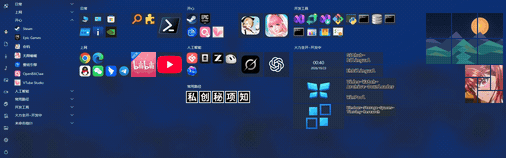
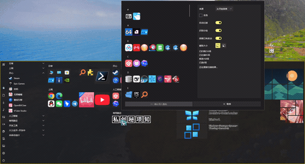

  

<h1 align="center">TileWall</h1>

  <a href="https://github.com/GitRuozhi/TileWall_for_Win11/blob/main/README.md">English</a> ·
  <a href="https://github.com/GitRuozhi/TileWall_for_Win11/blob/main/README.zh-CN.md"><strong>简体中文</strong></a> ·
  <a href="https://github.com/GitRuozhi/TileWall_for_Win11/blob/main/Showcase/readme/README.zh-TW.md">繁體中文</a> ·
  <a href="https://github.com/GitRuozhi/TileWall_for_Win11/blob/main/Showcase/readme/README.ja-JP.md">日本語</a> ·
  <a href="https://github.com/GitRuozhi/TileWall_for_Win11/blob/main/Showcase/readme/README.ko-KR.md">한국어</a> ·
  <a href="https://github.com/GitRuozhi/TileWall_for_Win11/blob/main/Showcase/readme/README.de-DE.md">Deutsch</a> ·
  <a href="https://github.com/GitRuozhi/TileWall_for_Win11/blob/main/Showcase/readme/README.fr-FR.md">Français</a> ·
  <a href="https://github.com/GitRuozhi/TileWall_for_Win11/blob/main/Showcase/readme/README.es-ES.md">Español</a>

  
  
  
  
  
  
  
  

  <a href="https://apps.microsoft.com/store/detail/9NZZN35FDB0C?cid=DevShareMCLPCS"><strong>官方安装</strong></a> ·
  <a href="https://github.com/GitRuozhi/TileWall_for_Win11/releases/latest">离线安装包</a> ·
  <a href="https://github.com/GitRuozhi/TileWall_for_Win11/discussions">反馈</a> ·
  <a href="https://qm.qq.com/cgi-bin/qm/qr?k=iw0LxnFaHE8JdUr5z937pFuagFxOtFOo&jump_from=webapi&authKey=JvkcK/IIaFg5e1ymzhP41yxcAiTVURjvhrNtDziZZSGj3ZD2byZhqX2lj48L9jkT">聊天</a>

  <picture>
    <source type="image/webp" srcset="https://raw.githubusercontent.com/GitRuozhi/TileWall_for_Win11/main/Showcase/readme/images/hero-zh.webp">
    
  </picture>

这是一张动态图，如果不动请单独查看 <a href="https://raw.githubusercontent.com/GitRuozhi/TileWall_for_Win11/main/Showcase/readme/images/hero-zh.webp">WebP</a> 和 <a href="https://raw.githubusercontent.com/GitRuozhi/TileWall_for_Win11/main/Showcase/readme/images/hero-zh.gif">GIF</a>。

## **复活吧！我的磁贴！**

**TileWall** 是一款独立磁贴启动墙，提供个性化的图片、相册与拼图玩法，在 Windows 11 上重现 Windows 10 熟悉的磁贴和开始菜单体验。

支持 Windows 10 和 Windows 11，适用于 x64 电脑，提供简体中文和英文。

**TileWall** 使用 Windows 原生界面框架 WinUI 3 开发，重现了开始菜单和磁贴墙，默认按 **Win + 反引号键** 呼出，与系统开始菜单互相独立。不用替换 Windows Shell，也不用改变原来的使用习惯。

可以通过[**微软商店**](https://apps.microsoft.com/store/detail/9NZZN35FDB0C?cid=DevShareMCLPCS)安装，也可以下载[便携压缩包](https://github.com/GitRuozhi/TileWall_for_Win11/releases/latest)或 [EXE 离线安装包](https://github.com/GitRuozhi/TileWall_for_Win11/releases/latest)。便携版解压后即可运行，三种分发方式共用当前用户的磁贴墙数据，数据位置为 `%LOCALAPPDATA%\TileWall`。

## 拼图、图片与图集

不再需要自行分割和对齐图片，在一个页面上搞定所有！

把图片设为目标， **TileWall** 会自动启用图片磁贴；

把含有可用图片的文件夹设为目标， **TileWall** 会自动启用图集切换；向文件夹中增加减少图片， **TileWall** 会自动更新图集，无需在编辑页修改。

普通快捷方式磁贴，也能自定义外观为图片或图集。

拼图模式下，在预览的内部格线上左击和右击可以进行分割或合并，滚动鼠标滚轮就可以快速改变图片缩放。

  <picture>
    <source type="image/webp" srcset="https://raw.githubusercontent.com/GitRuozhi/TileWall_for_Win11/main/Showcase/readme/images/puzzle-edit-zh.webp">
    
  </picture>

这是一张动态图，如果不动请单独查看 <a href="https://raw.githubusercontent.com/GitRuozhi/TileWall_for_Win11/main/Showcase/readme/images/puzzle-edit-zh.webp">WebP</a> 和 <a href="https://raw.githubusercontent.com/GitRuozhi/TileWall_for_Win11/main/Showcase/readme/images/puzzle-edit-zh.gif">GIF</a>。

## 复刻 Windows 10 开始菜单体验

按下 <kbd>Win</kbd> + <kbd>&#96;</kbd>（数字 1 左侧的键，无需 Shift），磁贴墙就会出现。默认情况下，成功启动目标或把焦点切到别处，墙会自动收起。

想让它像常规软件一样留在桌面上，可以取消总在最前、开启常驻显示。

拖动磁贴调整位置，拖动分组标题移动整组，按自己的习惯布置这面墙。

拖拽磁贴墙边缘可以调整窗口大小，也可以在设置中切换全屏与窗口模式。全屏时，向内拖动可调整的边缘或角落，可以回到窗口模式。

桌面四角都能作为锚点，比原生更自由。

布置满意后，可以在设置中开启**布局锁**，固定墙的可见大小、锚点和分组位置。单块磁贴仍能移到已有组内放得下的空位，不挤动其他内容；重启后也会保持锁定。

还可以在设置中开启**替换系统开始（实验）**，用 Win 键或点击开始按钮呼出 TileWall，随时可以关闭此选项，恢复原生开始菜单的入口。

  <picture>
    <source type="image/webp" srcset="https://raw.githubusercontent.com/GitRuozhi/TileWall_for_Win11/main/Showcase/readme/images/wall-drag-zh.webp">
    
  </picture>

这是一张动态图，如果不动请单独查看 <a href="https://raw.githubusercontent.com/GitRuozhi/TileWall_for_Win11/main/Showcase/readme/images/wall-drag-zh.webp">WebP</a> 和 <a href="https://raw.githubusercontent.com/GitRuozhi/TileWall_for_Win11/main/Showcase/readme/images/wall-drag-zh.gif">GIF</a>。

## 更强的功能

磁贴支持文件、文件夹、快捷方式、网页等多种启动方式，以及 Steam 等已在系统中注册的应用协议链接。

你可以把任意程序、目录、文件、网站放到同一面墙上，打造你专属的完整入口。

同时支持墙面右键新建和资源管理器的经典右键入口。

自动图标支持读取程序、快捷方式和应用包中的原生高清资源，并按显示需要选择合适尺寸；常用网站还有随包提供的离线图标。喜欢自己的搭配，也可以随时手动换图。

想快速布置？导入页面支持从开始菜单、桌面、已安装应用、系统功能和墙文件中批量添加磁贴，支持筛选、自动过滤和分组，不再需要一个个右键添加。

支持将选中的磁贴、拼图和图集导出为 ZIP 分享文件，也可以导入别人分享的磁贴墙。

取消固定的磁贴会进入 TileWall 回收站，需要时可以从“导入和导出 → 回收站”中选择恢复。

如果你也怀念开始菜单，打开设置中的**菜单式开始**，列表与磁贴会并排显示，两边访问同一批入口。

  <picture>
    <source type="image/webp" srcset="https://raw.githubusercontent.com/GitRuozhi/TileWall_for_Win11/main/Showcase/readme/images/start-import-zh.webp">
    
  </picture>

这是一张动态图，如果不动请单独查看 <a href="https://raw.githubusercontent.com/GitRuozhi/TileWall_for_Win11/main/Showcase/readme/images/start-import-zh.webp">WebP</a> 和 <a href="https://raw.githubusercontent.com/GitRuozhi/TileWall_for_Win11/main/Showcase/readme/images/start-import-zh.gif">GIF</a>。

## 即将

以下需求正在排期中，敬请期待：

- 批量编辑

- 多显示器支持

- 自主磁贴高清化

- 更多原生小组件

- 完整键盘操作与无障碍支持

- 更多语言

- Windows 原生高级覆盖（探索中）

- Arm 支持

## 已兑现

以下需求已完成：

- 布局锁

- 替换系统开始

- 磁贴墙分享

- 更多系统导入来源

- 磁贴回收站

- exe 软件与 Windows 应用原生高清图标

- 常用网站高清图标

- 微软商店上架

## 交流和反馈

点击 [Discussions](https://github.com/GitRuozhi/TileWall_for_Win11/discussions) 留下反馈、问题、新想法、晒晒磁贴墙。

点击 [轻松交流](https://qm.qq.com/cgi-bin/qm/qr?k=iw0LxnFaHE8JdUr5z937pFuagFxOtFOo&jump_from=webapi&authKey=JvkcK/IIaFg5e1ymzhP41yxcAiTVURjvhrNtDziZZSGj3ZD2byZhqX2lj48L9jkT) 加入 QQ 群，欢迎聊天吹水。

留个 Star 吧，拜托了，欧内该！ (｡•́︿•̀｡)