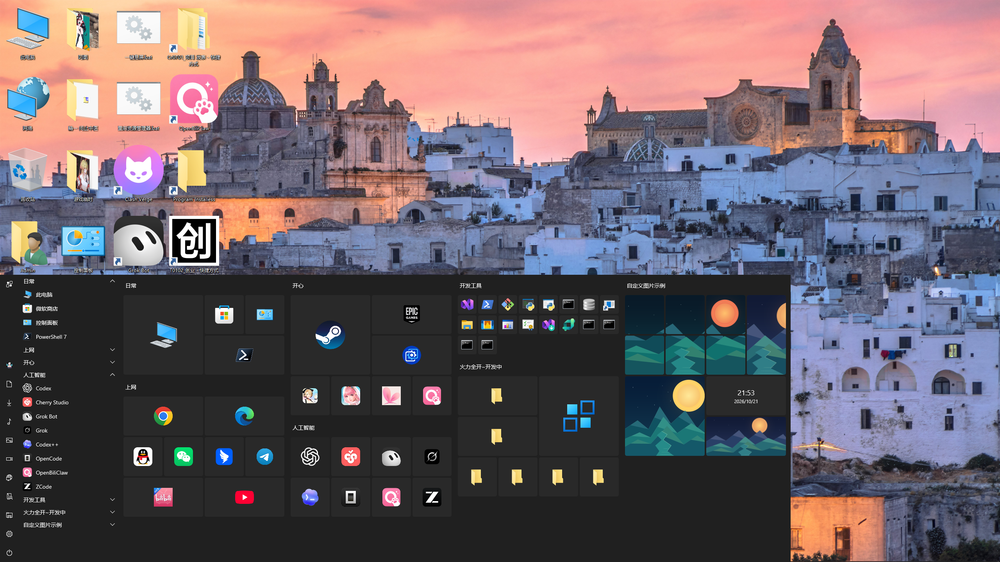
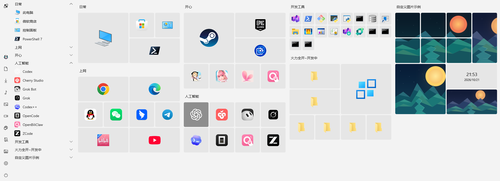
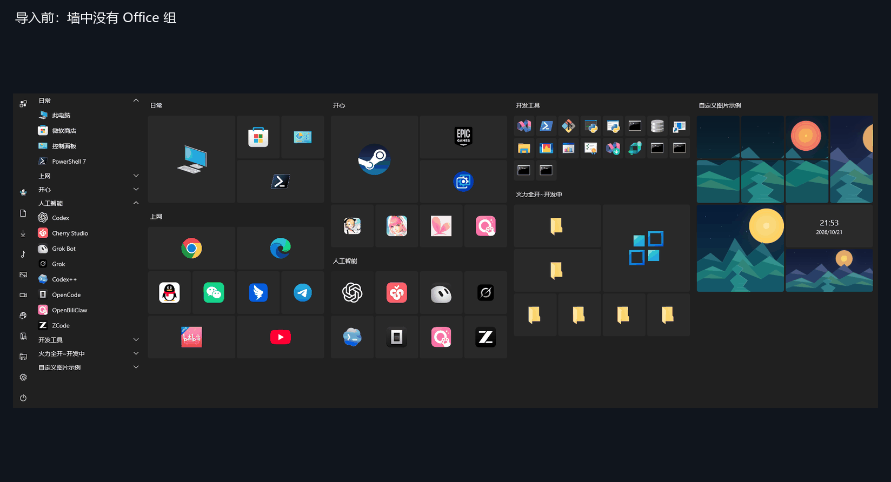

# TileWall

[English → README.md](README.md) · [简体中文 → README.zh-CN.md](README.zh-CN.md)

**把每天要用的东西，摆在顺手的位置。**

常用程序、工作文件夹、经常打开的网站，不妨给它们一个固定的位置。TileWall 是一款独立的 Windows 磁贴启动墙：按你的习惯分组，换上喜欢的图片，需要时用快捷键叫出来。

如果你还惦记 Windows 10 的磁贴，这里有那份熟悉感，也有留给你自己布置的空间。系统开始菜单和 Win 键照常使用。



## 现在可以用到什么？

- **常用入口，自己排。** 程序、文件、文件夹、快捷方式和网址都可以放上墙。按工作、游戏或自己的习惯分组，拖动调整位置。
- **图片，也能成为主角。** 给磁贴换一张图，或选一个图片文件夹轮换显示。喜欢完整的画面，就把它做成拼图，让一张图跨过几块磁贴。整幅拼图共用一个启动目标。
- **留一点自己的风格。** 亮色、暗色、方角、圆角，搭配喜欢的背景；也能放上时间和日期。不想从头布置，可以先从开始菜单导入。



## 获取 TileWall

**TileWall 0.3.1 提供 x64 便携版下载，完整解压 ZIP 后运行 `TileWall.exe`。**

[查看发行情况](https://github.com/GitRuozhi/TileWall_for_Win11/releases) · [查看源码](https://github.com/GitRuozhi/TileWall_for_Win11)

当前本机开发构建为 0.3.3，未制作该版本安装包或 Release。现有 0.3.2 Preview 本地候选包含便携 ZIP 和未签名的 x64 EXE 安装包，目前尚未发布到 Releases。MSIX 签名安装及 Win11 首层新右键菜单暂缓，待商店注册后再推进。

EXE 默认安装到公共的 `%ProgramFiles%\TileWall`，开始菜单直接显示 TileWall，不再套文件夹。安装时可选择“创建桌面快捷方式”，首次默认不勾选。安装、更新和卸载需要管理员批准，日常正常启动即可。安装器不自动开启登录启动或注册资源管理器右键菜单。便携 ZIP 和 EXE 均随附所需的 .NET 与 Windows App SDK 运行时。

面向 Windows 10 22H2 和 Windows 11 开发；Windows 11、多 DPI、未预装运行时的干净环境及正式签名安装仍待完整实测。愿意自行编译的话，文末有构建入口。

## 先放几个常用的进去

已有可运行的构建时，可以这样开始：

1. **打开墙。** 在完整的发布目录中运行 `TileWall.exe`。默认用 <kbd>Win</kbd> + <kbd>~</kbd> 呼出，也可以双击系统托盘里的 TileWall 图标。这里的 `~` 指与反引号同键的按键，不用按 Shift；快捷键可以在设置中修改。
2. **加几个每天都用的。** 在墙面空白处右键，选择 **导入**，来源选 **从开始菜单**。列表默认全不选，勾选想要的几项，再点 **确认导入整批**。已有缓存的入口和图标先显示，来源列表在后台继续刷新。
3. **摆成自己的样子。** 点击磁贴打开目标；拖动调整位置，双击分组标题改名。想换名称、图片或大小，就右键磁贴，选择 **编辑**，改好后点 **保存**。



几个顺手的操作：

| 想做什么 | 怎么操作 |
| --- | --- |
| 收起墙面 | 在主墙按 <kbd>Esc</kbd>；编辑文字或拖动时，先结束当前操作 |
| 手动添加内容 | 墙面空白处右键，新建磁贴或拼图；时钟在 **添加组件 → 时间和日期** 中 |
| 移动一整个分组 | 拖动分组标题 |
| 在菜单中展开分组 | 最多同时展开五组；展开第六组时，最早展开的那组会收起。重启后按分组 ID 恢复展开状态 |
| 撤回刚才的操作 | 在主墙按 <kbd>Ctrl</kbd> + <kbd>Z</kbd>，使用当前有效的撤销点 |

设置里还能调整主题、背景、呼出快捷键和登录后启动。0.3.2 候选中的 **添加到右键菜单** 可为单个文件或文件夹启用资源管理器经典右键入口。先把常用的几个入口放顺手，其余的慢慢再折腾。

## 整理之前，知道这几件事就够了

- 新建磁贴会先放到墙上，再打开编辑页；此时取消编辑，默认磁贴仍会留下。
- 再次导入可能重新排列位置；“保留已有改动”保留的是图片、尺寸、标题等设置，不保证原来的排布。
- “取消固定”不会删除外部原文件；误操作请及时撤销。目前还没有可在重启后找回取消固定项目的列表。
- 单张图片和自定义墙背景会在保存时保留一份原图；图集仍跟随你选择的文件夹。
- 便携版和 EXE 安装版在同一 Windows 用户下共用 `%LOCALAPPDATA%\TileWall` 和一个运行实例，切换入口前先退出旧实例；卸载 EXE 保留这份数据。想备份布置，先退出 TileWall，再复制整个目录。MSIX 使用单独的数据目录。开发阶段暂不提供旧格式的自动迁移。

## 有问题，直接说

[到 Issues 留言](https://github.com/GitRuozhi/TileWall_for_Win11/issues)。告诉我你原本想做什么、实际发生了什么，再附上 Windows 版本、缩放比例和 TileWall 版本；方便的话，带一张截图或一小段录屏。

如果你只是有个想法，也欢迎聊聊：你想把什么放上墙，哪一步用起来不顺手？

## 许可

项目计划免费提供使用，包括企业内部办公；正式许可文本尚未发布，发布前保留所有权利。源码公开不代表采用了开源许可证，商业分发及衍生授权仍需另行明确。[第三方组件说明](src/TileWall/THIRD-PARTY-NOTICES.txt)。

<details>
<summary>想自己编译？</summary>

需要 Windows、.NET SDK 10，以及相应的 Windows SDK / Visual Studio C++ 构建工具。以下命令生成便携发布目录；安装器和发行打包脚本不包含在公开源码镜像中。在仓库根目录运行：

```powershell
dotnet publish src/TileWall/TileWall.csproj -c Release -r win-x64 --self-contained true -p:Platform=x64 -p:WindowsPackageType=None -o artifacts/Release/TileWall
```

完成后，从 `artifacts/Release/TileWall` 运行 `TileWall.exe`，保留同目录的完整文件。不要只复制一个 EXE，也不要直接运行缺少发布资源的编译目录。此命令是便携构建入口，不代表已完成正式发行验收。

</details>
