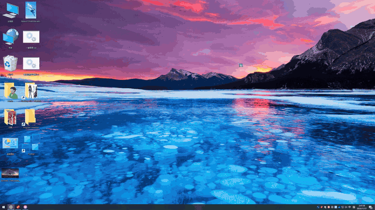
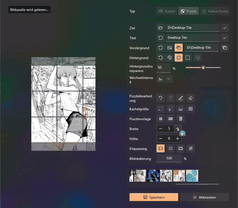
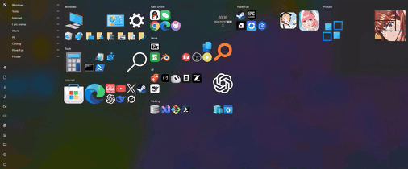
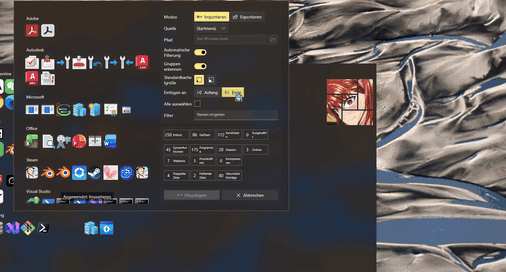
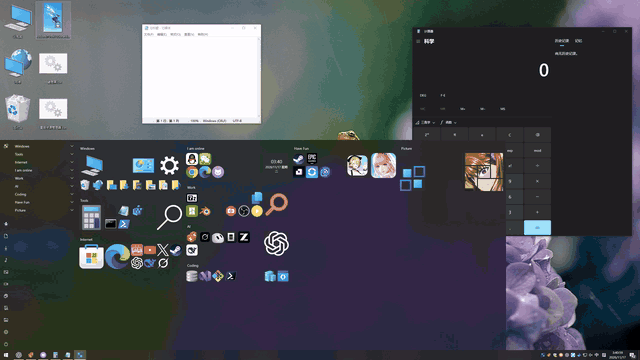

  

<h1 align="center">TileWall</h1>

  <a href="https://github.com/GitRuozhi/TileWall/blob/main/README.md">English</a> ·
  <a href="https://github.com/GitRuozhi/TileWall/blob/main/README.zh-CN.md">简体中文</a> ·
  <a href="https://github.com/GitRuozhi/TileWall/blob/main/Showcase/readme/README.zh-TW.md">繁體中文</a> ·
  <a href="https://github.com/GitRuozhi/TileWall/blob/main/Showcase/readme/README.ja-JP.md">日本語</a> ·
  <a href="https://github.com/GitRuozhi/TileWall/blob/main/Showcase/readme/README.ko-KR.md">한국어</a> ·
  <a href="https://github.com/GitRuozhi/TileWall/blob/main/Showcase/readme/README.de-DE.md"><strong>Deutsch</strong></a> ·
  <a href="https://github.com/GitRuozhi/TileWall/blob/main/Showcase/readme/README.fr-FR.md">Français</a> ·
  <a href="https://github.com/GitRuozhi/TileWall/blob/main/Showcase/readme/README.es-ES.md">Español</a>

  
  
  
  
  
  
  
  
  

  <a href="https://apps.microsoft.com/store/detail/9NZZN35FDB0C?cid=DevShareMCLPCS"><strong>Offizielle Installation</strong></a> ·
  <a href="https://github.com/GitRuozhi/TileWall/releases/latest">Offline-Installationspaket</a> ·
  <a href="https://github.com/GitRuozhi/TileWall/discussions">Feedback</a> ·
  <a href="https://qm.qq.com/cgi-bin/qm/qr?k=iw0LxnFaHE8JdUr5z937pFuagFxOtFOo&jump_from=webapi&authKey=JvkcK/IIaFg5e1ymzhP41yxcAiTVURjvhrNtDziZZSGj3ZD2byZhqX2lj48L9jkT">Chat</a>

https://github.com/user-attachments/assets/1ea64b8a-82db-4d76-9d7e-e8d279c6b613

## **Erhebt euch wieder, meine Kacheln!**

**TileWall** bildet das klassische Kachel-Startmenü und den Startbildschirm von Windows 10 unter Windows 11 vollständig nach. Kachel anklicken zum Starten, Rechtsklick zum Verwalten, per Drag-and-drop frei anordnen – alles wie bisher, ohne Umgewöhnung.

Nutze TileWall als eigenständigen Launcher neben dem Systemmenü und rufe es mit **Win + ~** (die Taste links neben der 1) auf, oder ersetze das Startmenü von Windows, sodass die **Win**-Taste oder die Startschaltfläche TileWall öffnet. Ganz so, wie es zu dir passt.

Auf dem nativen WinUI-3-Framework von Microsoft gebaut, für Windows 10 und 11 auf x64 und ARM64. Open Source, kostenlos, leichtgewichtig und werbefrei.

Offizielle Installation: [**Microsoft Store öffnen**](https://apps.microsoft.com/store/detail/9NZZN35FDB0C?cid=DevShareMCLPCS)

Offline-Installationspaket: [EXE-Offline-Installationspaket herunterladen](https://github.com/GitRuozhi/TileWall/releases/latest)

Portables Archiv: [Portables Archiv herunterladen](https://github.com/GitRuozhi/TileWall/releases/latest)

Datenpfad: `%LOCALAPPDATA%\TileWall`

  <picture>
    <source type="image/webp" srcset="images/hero-de-DE.webp">
    
  </picture>

Dies ist ein animiertes Bild. Wenn es sich nicht bewegt, öffne <a href="images/hero-de-DE.webp">WebP</a> und <a href="images/hero-de-DE.gif">GIF</a> einzeln.

## Puzzles, Bilder und Bilderalben

Du musst Bilder nicht mehr selbst zuschneiden und ausrichten – alles auf einer Seite!

Lege ein Bild als Ziel fest, und **TileWall** aktiviert automatisch Bildkacheln.

Lege einen Ordner mit unterstützten Bildern als Ziel fest, und **TileWall** schaltet automatisch den Albumwechsel ein. Wenn du Bilder im Ordner hinzufügst oder entfernst, aktualisiert **TileWall** das Album automatisch, ohne dass du die Bearbeitungsseite ändern musst.

Auch das Aussehen normaler Verknüpfungskacheln kannst du mit einem Bild oder Album anpassen.

Im Puzzlemodus kannst du auf den inneren Gitterlinien der Vorschau links oder rechts klicken, um Bereiche zu teilen oder zusammenzufügen. Mit dem Mausrad änderst du schnell die Bildvergrößerung.

  <picture>
    <source type="image/webp" srcset="images/puzzle-edit-de-DE.webp">
    
  </picture>

Dies ist ein animiertes Bild. Wenn es sich nicht bewegt, öffne <a href="images/puzzle-edit-de-DE.webp">WebP</a> und <a href="images/puzzle-edit-de-DE.gif">GIF</a> einzeln.

## Das Startmenü-Erlebnis von Windows 10 nachbilden

Drücke <kbd>Win</kbd> + <kbd>&#96;</kbd> (die Taste links neben der 1, ohne Umschalttaste), und die Kachelwand erscheint. Standardmäßig klappt sie automatisch ein, sobald ein Ziel erfolgreich gestartet wird oder der Fokus an eine andere Stelle wechselt.

Wenn sie wie eine normale App auf dem Desktop sichtbar bleiben soll, deaktiviere „Immer im Vordergrund“ und aktiviere „Dauerhaft anzeigen“.

Ziehe Kacheln an eine andere Stelle und ziehe einen Gruppentitel, um die ganze Gruppe zu verschieben. Richte die Wand ganz nach deinen Gewohnheiten ein.

Ziehe am Rand der Kachelwand, um die Fenstergröße anzupassen. In den Einstellungen kannst du zwischen Vollbild- und Fenstermodus wechseln. Ziehe im Vollbildmodus an einer verstellbaren Kante oder Ecke nach innen, um zum Fenstermodus zurückzukehren.

Alle vier Ecken des Desktops können als Anker dienen – so hast du mehr Freiheit als mit dem nativen Startmenü.

Wenn dir dein Layout gefällt, kannst du in den Einstellungen **Layout sperren** aktivieren. Dadurch bleiben die sichtbare Größe der Wand, der Anker und die Gruppenpositionen fest. Einzelne Kacheln lassen sich weiterhin auf ausreichend große freie Plätze in vorhandenen Gruppen verschieben, ohne andere Inhalte zu verdrängen. Auch nach einem Neustart bleibt die Sperre aktiv.

Mit **Systemstartmenü ersetzen (Experiment)** in den Einstellungen kannst du TileWall über die Windows-Taste oder einen Klick auf die Start-Schaltfläche öffnen. Deaktiviere die Option jederzeit, um wieder das native Startmenü zu verwenden.

  <picture>
    <source type="image/webp" srcset="images/wall-drag-de-DE.webp">
    
  </picture>

Dies ist ein animiertes Bild. Wenn es sich nicht bewegt, öffne <a href="images/wall-drag-de-DE.webp">WebP</a> und <a href="images/wall-drag-de-DE.gif">GIF</a> einzeln.

## Noch mehr Funktionen

Kacheln können Dateien, Ordner, Verknüpfungen, Websites und vieles mehr öffnen. Außerdem unterstützen sie App-Protokoll-Links, die in Windows registriert sind, etwa von Steam.

Lege Programme, Ordner, Dateien und Websites auf dieselbe Kachelwand und baue dir deinen persönlichen Startpunkt für alles.

Neue Kacheln kannst du über das Rechtsklickmenü der Kachelwand oder das klassische Kontextmenü des Datei-Explorers erstellen.

Automatische Symbole lesen native hochauflösende Ressourcen aus Programmen, Verknüpfungen und App-Paketen und wählen eine passende Größe für die Anzeige. Für häufig genutzte Websites sind außerdem Offline-Symbole enthalten. Wenn du lieber eigene Symbole verwendest, kannst du sie jederzeit ändern.

Du möchtest alles schnell einrichten? Über die Importseite kannst du Kacheln aus dem Startmenü, vom Desktop, aus installierten Apps, aus Systemfunktionen und aus Kachelwand-Dateien hinzufügen. Filter, automatische Filterung und Gruppierung ersparen dir das einzelne Hinzufügen per Rechtsklick.

Ausgewählte Kacheln, Puzzles und Bilderalben kannst du als ZIP-Datei zum Teilen exportieren. Außerdem kannst du geteilte Kachelwände anderer importieren.

Nicht mehr angeheftete Kacheln landen im TileWall-Papierkorb. Bei Bedarf kannst du sie unter „Import und Export → Papierkorb“ wiederherstellen.

Wenn du auch das Startmenü vermisst, aktiviere in den Einstellungen **Startmenü im Listenstil**. Liste und Kacheln erscheinen nebeneinander und bieten Zugriff auf dieselben Einträge.

  <picture>
    <source type="image/webp" srcset="images/start-import-de-DE.webp">
    
  </picture>

Dies ist ein animiertes Bild. Wenn es sich nicht bewegt, öffne <a href="images/start-import-de-DE.webp">WebP</a> und <a href="images/start-import-de-DE.gif">GIF</a> einzeln.

Klicke im Datei-Explorer mit der rechten Maustaste auf eine beliebige Datei und wähle „Zu TileWall hinzufügen“, um eine Kachel zu erstellen.

  <picture>
    <source type="image/webp" srcset="images/desktop-add-de-DE.webp">
    
  </picture>

Dies ist ein animiertes Bild. Wenn es sich nicht bewegt, öffne <a href="images/desktop-add-de-DE.webp">WebP</a> und <a href="images/desktop-add-de-DE.gif">GIF</a> einzeln.

## Demnächst

Diese Punkte sind in Planung oder werden noch geprüft. Bleib gespannt:

- Mehrere Einträge auf einmal bearbeiten

- Unterstützung für mehrere Monitore

- Natives Widget – Uhr

- Natives Widget – Monatskalender

- Natives Widget – zuletzt und häufig verwendete Elemente

- Weitere native Widgets

- Vollständige Tastaturbedienung und Barrierefreiheit

## Bereits umgesetzt

Diese Wünsche sind bereits erfüllt:

- Layoutsperre

- Systemstartmenü ersetzen

- Kachelwand teilen

- Weitere Systemquellen für den Import

- Kachel-Papierkorb

- Native hochauflösende Symbole für EXE-Programme und Windows-Apps

- Hochauflösende Symbole für häufig genutzte Websites

- Im Microsoft Store veröffentlicht

- Native ARM64-Unterstützung

- Acht UI-Sprachen (der Systemsprache folgen oder manuell auswählen)

## Austausch und Feedback

Hinterlasse in [Discussions](https://github.com/GitRuozhi/TileWall/discussions) Feedback, Fragen oder neue Ideen – oder zeig dort deine Kachelwand.

Tritt der QQ-Gruppe bei, indem du auf [Locker austauschen](https://qm.qq.com/cgi-bin/qm/qr?k=iw0LxnFaHE8JdUr5z937pFuagFxOtFOo&jump_from=webapi&authKey=JvkcK/IIaFg5e1ymzhP41yxcAiTVURjvhrNtDziZZSGj3ZD2byZhqX2lj48L9jkT) klickst. Plaudern ist willkommen!

Lässt du mir einen kleinen Star da? Bitte, biiitte! (｡•́︿•̀｡)
