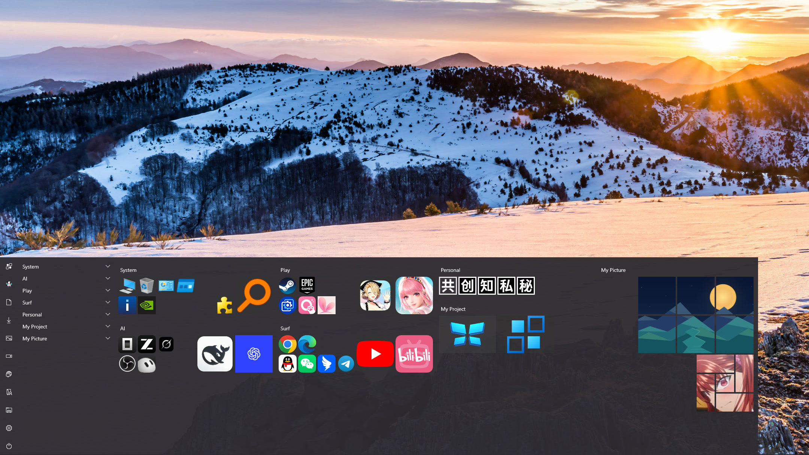
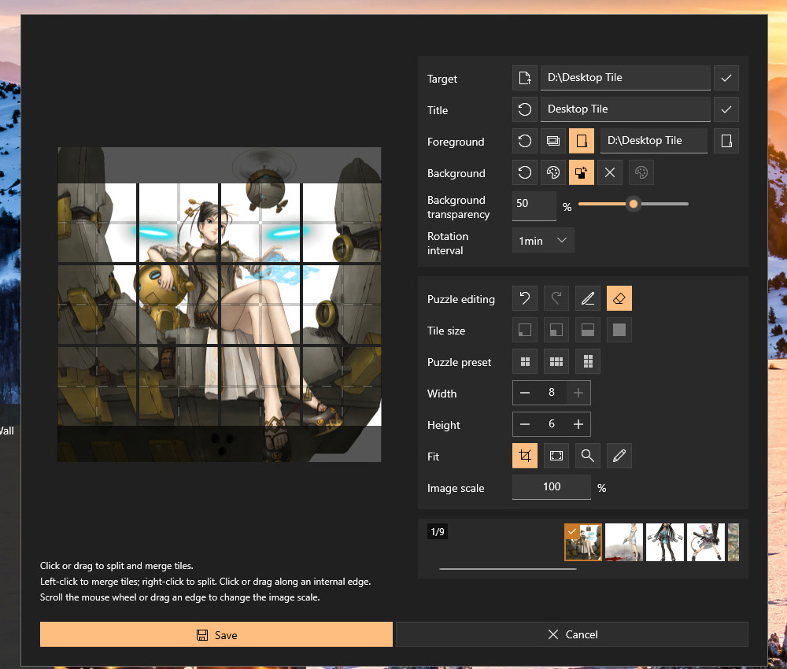
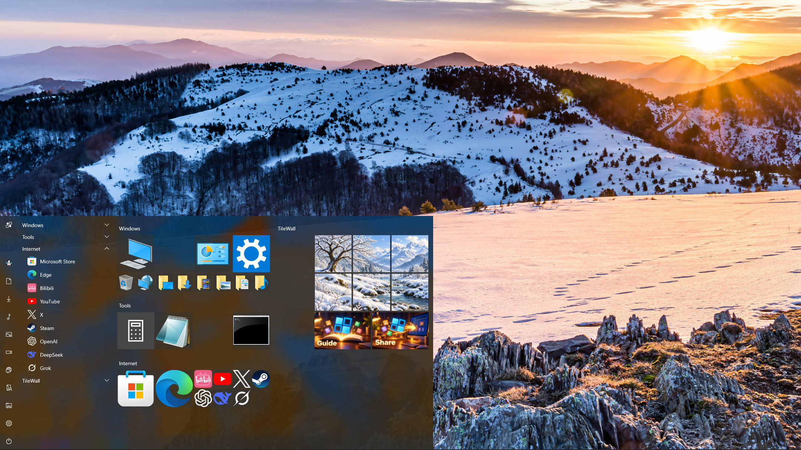
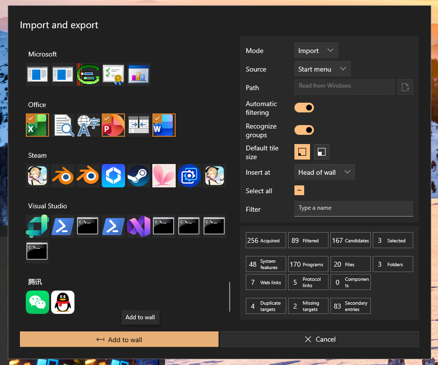
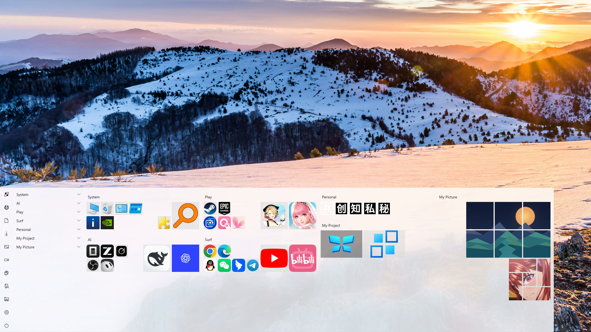

  

<h1 align="center">TileWall</h1>

V1.40 · 첫 Microsoft Store 정식 버전 제출 준비 중 (아직 스토어에 등록되지 않음)

  <a href="README.en-US.md">English</a> ·
  <a href="README.zh-CN.md">简体中文</a> ·
  <a href="README.zh-TW.md">繁體中文</a> ·
  <a href="README.ja-JP.md">日本語</a> ·
  <a href="README.ko-KR.md"><strong>한국어</strong></a> ·
  <a href="README.de-DE.md">Deutsch</a> ·
  <a href="README.fr-FR.md">Français</a> ·
  <a href="README.es-ES.md">Español</a>

  
  
  

  <a href="https://github.com/GitRuozhi/TileWall_for_Win11"><strong>프로젝트 홈</strong></a> ·
  <a href="https://github.com/GitRuozhi/TileWall_for_Win11/discussions">문제 및 의견</a> ·
  <a href="https://qm.qq.com/cgi-bin/qm/qr?k=iw0LxnFaHE8JdUr5z937pFuagFxOtFOo&jump_from=webapi&authKey=JvkcK/IIaFg5e1ymzhP41yxcAiTVURjvhrNtDziZZSGj3ZD2byZhqX2lj48L9jkT">편하게 이야기 나누기</a>

  

## **되살아나라! 나의 타일이여!**

**TileWall**은 그림, 앨범, 퍼즐을 원하는 대로 꾸밀 수 있는 독립형 타일 런처입니다. Windows 11에서 Windows 10의 익숙한 타일과 시작 메뉴 경험을 되살립니다.

**TileWall**은 Windows의 네이티브 UI 프레임워크인 WinUI 3로 개발했습니다. 시작 메뉴와 타일 벽을 재현하며, 기본적으로 **Win + 백틱 키(Shift 없이)**를 누르면 나타나고 Windows의 시작 메뉴와 별도로 동작합니다. Windows Shell을 바꿀 필요도, 기존 사용 습관을 바꿀 필요도 없습니다.

Windows 10 22H2(build 19045)와 Windows 11을 지원하며 x64 PC용입니다. 앱 UI는 중국어(간체)와 영어만 제공하고, 아래 스크린샷은 영어 UI입니다.

## 퍼즐, 그림과 앨범

그림을 직접 잘라 맞출 필요 없이 한 페이지에서 모두 해결하세요!

Split tiles(타일 분할)를 누른 다음 미리 보기의 점선에서 마우스 왼쪽 또는 오른쪽 버튼을 클릭하면 영역을 나누거나 합칠 수 있습니다. 마우스 휠을 굴려 그림 확대율을 빠르게 조정할 수 있습니다.

그림을 대상으로 설정하면 **TileWall**이 자동으로 그림 타일을 사용합니다.

지원되는 그림이 있는 폴더를 대상으로 설정하면 **TileWall**이 자동으로 앨범 전환을 켭니다. 폴더에 그림을 추가하거나 삭제하면 앨범도 자동으로 업데이트됩니다.

일반 바로 가기 타일도 그림이나 앨범으로 모양을 바꿀 수 있습니다.

  

## Windows 10 시작 메뉴 경험 재현

<kbd>Win</kbd> + <kbd>&#96;</kbd> (숫자 1 왼쪽의 키, Shift 없이)을 누르면 타일 벽이 나타납니다. 프로그램 실행에 성공한 뒤 또는 포커스를 다른 곳으로 옮기면 타일 벽이 자동으로 접혀 들어가며, 기본 시작 메뉴와 같은 방식으로 동작합니다.

일반 앱처럼 바탕 화면에 계속 띄워 두고 싶다면 항상 위에 표시를 끄고 상시 표시를 켜세요.

타일을 끌어 위치를 바꾸고 그룹 제목을 끌어 그룹 전체를 옮길 수 있습니다. 부드럽게 움직이며 기본 시작 메뉴와 같은 방식으로 동작합니다.

타일 벽 가장자리를 끌어 크기를 조절하고, 화면 가장자리로 끌어가 전체 화면과 창 모드를 매끄럽게 전환할 수 있습니다.

바탕 화면 네 모서리를 모두 기준점으로 쓸 수 있어 기본 시작 메뉴보다 자유롭습니다.

설정에서 시스템 시작 메뉴 대체를 켜면 Windows 키나 시작 버튼으로 TileWall을 열 수 있습니다. 언제든지 기본 시작 메뉴로 돌아갈 수 있습니다.

  

## 더 강력한 기능

타일에서 파일, 폴더, 바로 가기, 웹 페이지는 물론 Steam처럼 시스템에 등록된 앱 프로토콜 링크도 열 수 있습니다.

프로그램, 폴더, 파일, 웹 사이트를 한 타일 벽에 모아 나만의 통합 실행 공간을 만들 수 있습니다.

타일 벽의 오른쪽 클릭 메뉴와 파일 탐색기의 클래식 오른쪽 클릭 메뉴에서 새 타일을 만들 수 있습니다.

빠르게 설정하고 싶으신가요? 가져오기 페이지에서 시작 메뉴, 바탕 화면, 설치된 앱, 시스템 기능, 타일 벽 파일의 항목을 한꺼번에 추가할 수 있습니다. 필터링, 자동 제외, 그룹화도 지원해 일일이 오른쪽 클릭으로 추가할 필요가 없습니다.

선택한 타일, 퍼즐, 앨범을 공유 파일로 내보낼 수 있습니다.

고정 해제한 타일은 휴지통으로 이동하며 필요할 때 복원할 수 있습니다.

시작 메뉴가 그립다면 설정에서 **Start menu list(시작 메뉴 목록)**를 켜세요. 목록과 타일이 나란히 표시되고, 양쪽에서 같은 항목에 접근할 수 있습니다.

  

  

## 출시 예정

다음 요청을 개발 일정에 올려 두었습니다. 기대해 주세요!

- 일괄 편집

- 다중 모니터 지원

- 흐릿한 아이콘 고해상도화

- 네이티브 위젯 추가

- 완전한 키보드 조작 및 접근성 지원

- 더 많은 언어

- Windows 네이티브 고급 오버레이 (검토 중)

## 대화와 의견

[편하게 이야기 나누기](https://qm.qq.com/cgi-bin/qm/qr?k=iw0LxnFaHE8JdUr5z937pFuagFxOtFOo&jump_from=webapi&authKey=JvkcK/IIaFg5e1ymzhP41yxcAiTVURjvhrNtDziZZSGj3ZD2byZhqX2lj48L9jkT)를 눌러 QQ 그룹에 참여해 보세요. 편하게 이야기를 나누고 내 타일 벽도 자랑해 주세요!

문제나 새로운 아이디어가 있으면 [Discussions](https://github.com/GitRuozhi/TileWall_for_Win11/discussions)에 남겨 주세요. 하나하나 꼼꼼히 읽어 볼게요. (●ˇ∀ˇ●)

TileWall 덕분에 타일을 다시 좋아하게 되셨다면 Star를 남겨 주세요. 이런 수고를 좋아해 주는 사람이 있다는 걸 알면 기쁠 거예요. 오네가이!